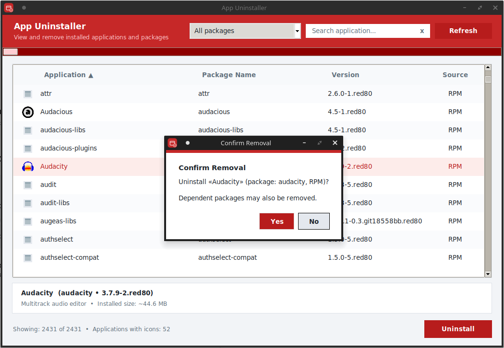

# App Uninstaller



A lightweight and intuitive graphical manager for viewing and uninstalling applications and system packages on Linux.

## Features
- **Multi-format support**: Automatically detects and manages `RPM` (`dnf`/`yum`), `Flatpak`, `Snap`, `APT` (`dpkg`), `Pacman`, and `Zypper`.
- **Application filter**: Switch between all system packages and GUI applications with icons.
- **Fast search & sorting**: Live search by name or package ID and column sorting.
- **Package details**: Inspect package summary and disk usage before removal.
- **System protection**: Warning prompt before removing critical OS components (`kernel`, `systemd`, `glibc`, `dnf`, etc.).
- **Flatpak Sandbox support**: Works seamlessly inside Flatpak via `flatpak-spawn --host`.

## Installation

### 1. RPM-based distributions (Red OS, Fedora, ALT, ROSA)
Download the `.rpm` file from **[Releases](https://github.com/releases)** and install it:
```bash
sudo dnf install ./app-uninstaller-*.noarch.rpm
```

### 2. Any Linux distribution (Flatpak)
Download the `.flatpak` file from **[Releases](https://github.com/releases)** and install it:
```bash
flatpak install --user ./app-uninstaller.flatpak
```

### 3. Run from source
Requires Python 3 and `tkinter` (optional `python3-pillow` for smooth icons):
```bash
python3 uninstaller.py
```
